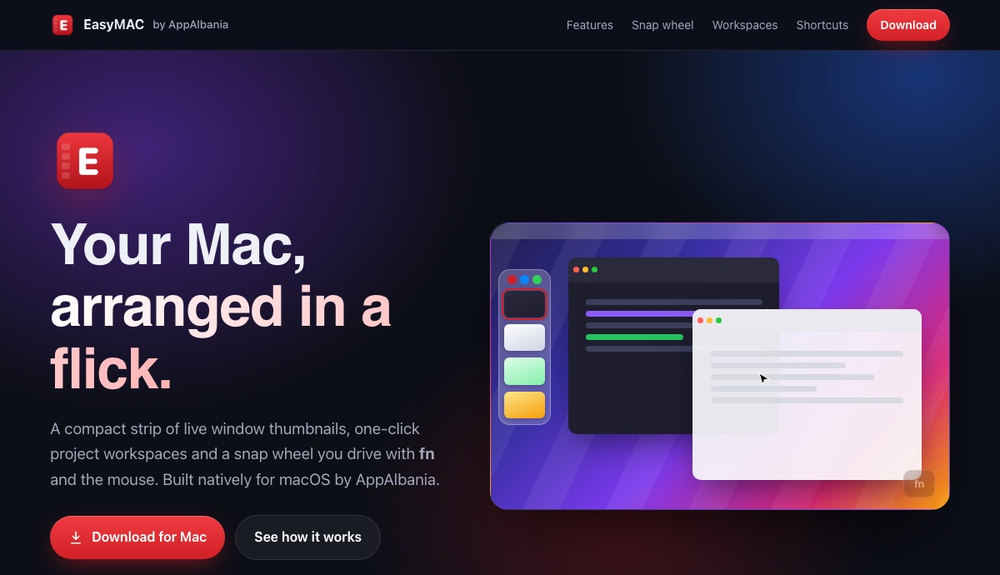

<p align="center">
  
</p>

<h1 align="center">EasyMAC by AppAlbania</h1>

<p align="center">
  A light, fast Stage Manager replacement for macOS: live window strip, workspaces, snap wheel,<br>
  clipboard history, files tray, Keep Awake and volume &amp; brightness in the notch.
</p>

<p align="center">
  <a href="https://appalbania.com/easymac/EasyMAC.dmg"></a>
  &nbsp;
  <a href="https://appalbania.com/easymac/"></a>
</p>

<p align="center">
  Free · macOS 14 or later · Notarized by Apple · Updates itself
</p>



## Build from source

Native macOS multitasking: a compact strip of live window thumbnails, one-click project workspaces,
tiling presets and a Loop-style **snap wheel** (hold **fn** + move the mouse).

```bash
brew install xcodegen
./scripts/install-local.sh     # build, install to /Applications, launch
./scripts/build-debug.sh       # debug build
NOTARY_PROFILE=… ./scripts/build-release.sh   # Developer ID + notarized DMG in dist/
```

## Shortcuts

| Action | Default |
|---|---|
| Show / hide sidebar | ⌥⇧S |
| Restore workspace 1–9 | ⌥1 … ⌥9 |
| Save current windows as workspace | ⌥⇧W |
| Window switcher | ⌥Tab (release ⌥ to focus) |
| Snap left / right / top / bottom | ⌃⌥ ← → ↑ ↓ (repeat left/right: ½ → ⅔ → ⅓) |
| Maximize / center / restore | ⌃⌥↩ / ⌃⌥C / ⌃⌥⌫ |
| Tile visible windows | ⌃⌥L |
| Snap wheel | hold fn, move mouse, release |

All shortcuts can be changed in Settings → Hotkeys. See `NOTES.md` for design decisions and limitations.
